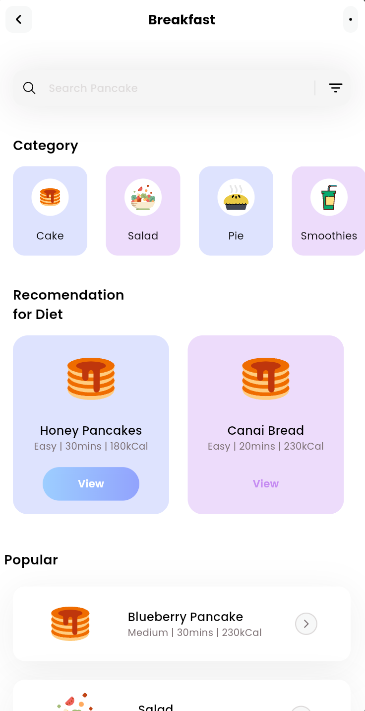

# 🥞 Breakfast & Diet UI — Flutter App

Aplikasi mobile antarmuka pengguna (UI) untuk rekomendasi menu sarapan dan diet sehat yang dibangun menggunakan **Flutter** dan **Dart**. Proyek ini berfokus pada penerapan *clean layout*, penggunaan aset vektor (`SVG`), pemisahan data menggunakan *Model Class*, serta komponen *scrollable list* horizontal dan vertikal.

## 📸 Tampilan Aplikasi

  

## ✨ Fitur & Implementasi Teknis
* **Custom AppBar & Search Bar:** Menggunakan `TextField` dengan dekorasi bayangan lembut (*BoxShadow*), `prefixIcon`, dan `suffixIcon` dengan `VerticalDivider`.
* **Horizontal Category & Diet Lists:** Implementasi `ListView.separated` horizontal dengan kartu gradasi warna (*LinearGradient*) dan indikator status seleksi.
* **Popular Diet Section:** Daftar menu vertikal dengan kartu dinamis dan tombol aksi interaktif.
* **Data Modeling:** Pemisahan struktur data menggunakan model (`CategoryModel`, `DietModel`, `PopularDietsModel`) agar kode UI tetap bersih dan terstruktur.

## 🛠️ Tech Stack & Package
* **Framework:** Flutter
* **Language:** Dart
* **Packages:** `flutter_svg`
